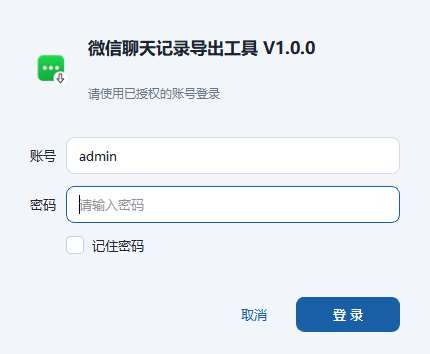
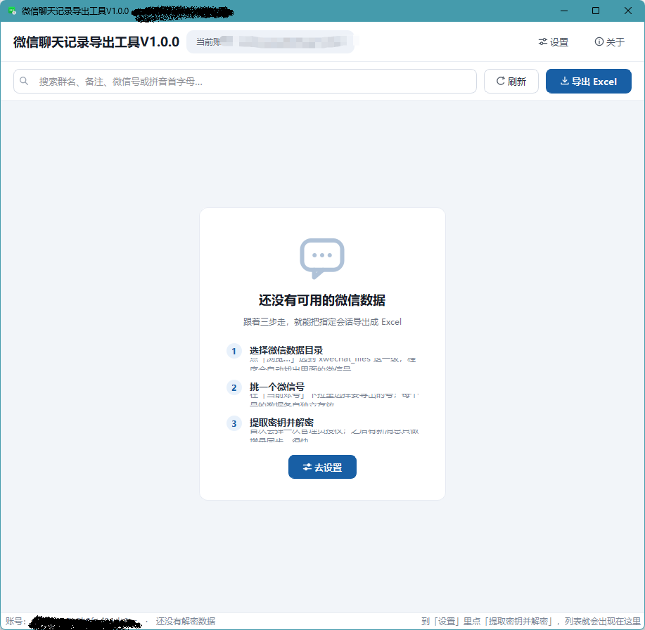
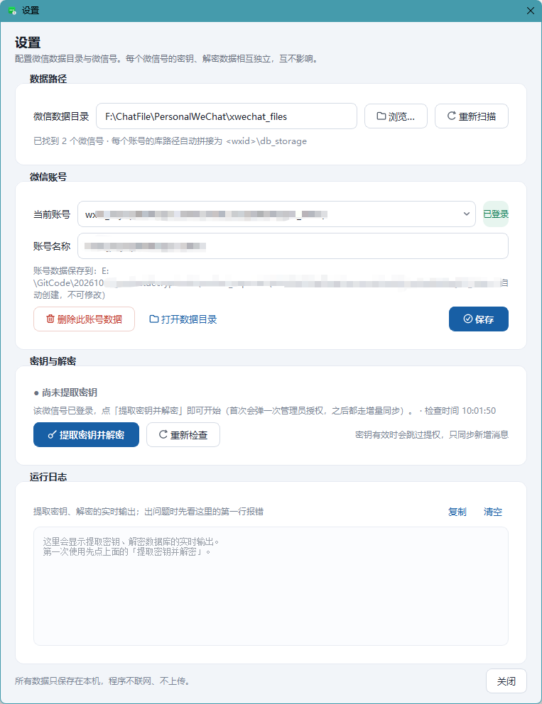
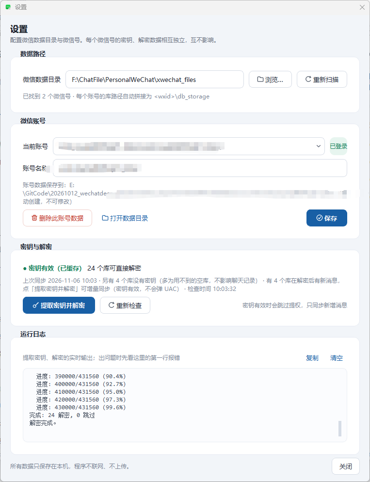
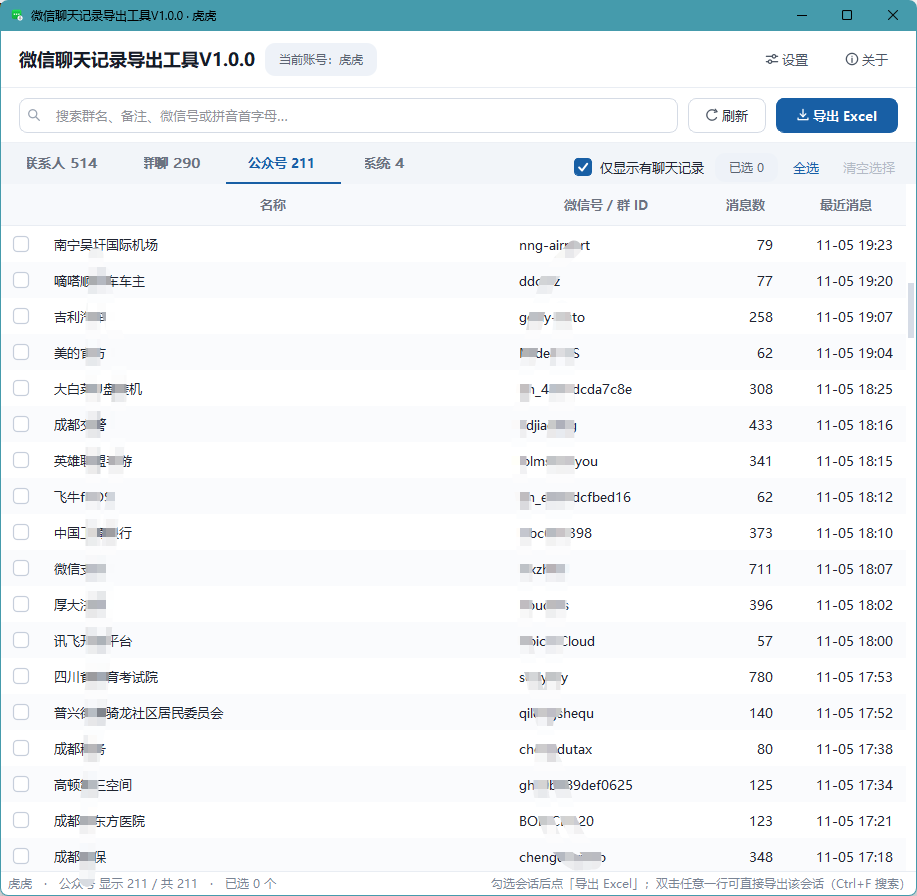
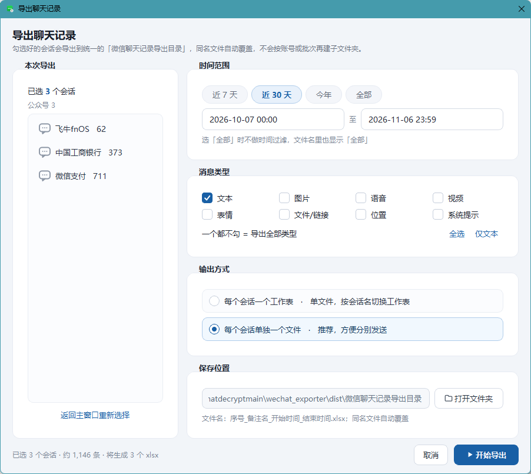

# 微信聊天记录导出工具

从本机微信（Windows，**4.1.10.31 及以上，含 4.2.x**）的加密数据库里读聊天记录，
按**会话**和**时间范围**导出成 Excel。全程只在本机处理，不联网、不上传。

| 项 | 值 |
|---|---|
| 程序名 | 微信聊天记录导出工具 |
| 版本 | V1.0.0 |
| 入口 | `main.py` |
| 打包产物 | `dist\微信聊天记录导出工具V1.0.0.exe`（单文件，约 45 MB） |
| 平台 | Windows 10 / 11（需要读进程内存，只支持 Windows） |

---

## 一、它是怎么工作的

微信 4.x 的本地库是 SQLCipher 4 加密的：

```
加密算法   AES-256-CBC + HMAC-SHA512
KDF        PBKDF2-HMAC-SHA512，256,000 轮
页大小     4096 字节，reserve = 80（IV 16 + HMAC 64）
每个库独立 salt（文件前 16 字节，明文）和 enc_key
```

本程序不试图破解密码，而是**从微信自己的进程里把密钥取出来**——微信要读写库，
密钥必然在它内存里。难点在于微信不同版本放密钥的方式不一样：

| 微信版本 | 密钥在内存里的形态 | 取法 |
|---|---|---|
| 4.0 ~ 4.1.10.30 | 明文 `x'<64hex enc_key><32hex salt>'` | 正则扫内存直接匹配（本程序不覆盖这段，用旧版工具） |
| **4.1.10.31+ / 4.2.x** | 只有混淆后的 32 字节 raw 候选 | 本程序的做法，见下 |

> 实测环境：微信 **4.2.0.13**，单账号 22 个库全部通过 HMAC 校验并解密成功。

**本程序的密钥链路（四步，缺一不可）**

```
1. scan.py          读注册表 HKCU\Software\Tencent\Weixin 的 InstallPath，
                    定位 <版本号>\Weixin.dll，静态扫 .text 段
                    → 找 "4 条 mov rdx, imm64 + test rax,rax" 的指令序列
                    → 取出 4 个 8 字节立即数拼成 32 字节 XOR 常量候选
                    （纯静态，不需要微信在跑）

2. key_v4.py        只读扫 Weixin.exe 内存（MEM_COMMIT + MEM_PRIVATE），
                    YARA 规则匹配"指针桩"，顺着指针读 32 字节 → raw 候选
                    → 先按熵/字符分布粗筛，把候选压到百来个量级

3. get_key_v42.py   raw 候选 XOR 第 1 步的常量 = 账号级 passphrase
                    → 用某个库第 1 页的 HMAC 验真，命中即确定
                    → 写 keys.json（每库 enc_key）+ passphrase.txt

4. decrypt_db.py    passphrase + 每个库的 salt → PBKDF2 派生该库 enc_key
                    → 逐页 AES 解密，输出明文 .db
```

两个关键点：

- **密钥是账号级的**。同一个微信号下所有库共用一份 passphrase，每个库的 enc_key
  由 `passphrase + 该库 salt` 现场派生。所以只要拿到一份 passphrase，
  微信以后新建的库也能免提权补上（`passphrase.txt` 就是干这个用的）。
- **判据只有 HMAC**。不做"解密后看内容像不像"这种猜测：重算第 1 页 HMAC
  与文件里存的 64 字节比对，相等即密钥正确，一次就够。

### 媒体（图片 / 视频 / 语音 / 文件 / 表情）解密

数据库只存"消息记录"，真实的图片 / 视频 / 语音 / 文件是另一回事：它们按原始字节加密后
存成 `.dat` 文件，数据库里只留一条 XML（缩略图 md5、aeskey、cdn 地址等元信息）。
媒体解密由 `core/media.py` 负责，与数据库解密是两条独立的链路：

| 微信版本 | 媒体加密 | 是否需要微信在跑 | 是否需要密钥 |
|---|---|---|---|
| 3.x 经典版 | 图片 `.dat` 单字节 **XOR**（key 可由文件头反推） | 否 | **否**（离线即可解） |
| 4.x V1 | `.dat` = AES-128-ECB + XOR，**固定 key** `md5("0")[:16]` | 否 | 否 |
| 4.x V2（2025-08+） | `.dat` = AES-128-ECB + XOR，**key 从内存提** | 是（看图的瞬间） | **是** |

4.x V2 的 AES key 是一个 16 字节 ASCII 字符串，只在"你正在看这张图"的瞬间短暂存在于
微信进程内存。要提取它，必须微信在运行 + 本程序以管理员权限去读进程内存
（`scan_memory_for_aes_key()` 复用取库密钥的 VirtualQueryEx / ReadProcessMemory 思路）。
XOR 段 key 默认 `0x88`，图片也可从缩略图尾部的 `FF D9` 反推（`find_xor_key_4x()`）。

> **头布局（4.2 实测更正）**：`07 08 56 32 08 07 00 04` 不是"新的 8 字节签名"，
> 而是 `sig6 + aes_size(u32 LE) + xor_size(u32 LE)`，`aes_size` 恒为 1024。
> 首块 AES 密文在**偏移 15**；`15 + aligned(aes_size) + xor_size == 文件长度`，
> 且 `aes_size + xor_size == XML 的 length`。`decode_dat_bytes()` 现在按这份
> 自洽布局走 `decrypt_v2()`，`decrypt_v2_4x()` 只留给极少数不自洽的样本。

`.dat` 外壳解密后，按文件头 magic 判定真实格式：jpg / png / gif / webp / hevc(微信视频裸流) /
tif / bmp / mp4 / mov / silk(语音，仍需转码才能播放) / amr / zip / rar / 7z / pdf …
语音是 silk 编码，解到 `.silk` 后还需 silk→pcm→wav 才能播放（**本模块只负责解密，不转码**）。

> 对话框查看器已接入媒体展示（`ui/chat_media.py`）：`packed_info_data` 取本地
> hash → 定位 `.dat` → 免密钥解密 → 固定尺寸画框（图片/视频 220×160、表情 96×96）；
> V2 图片给等尺寸加密占位。若拿到 16 字符 key，放到账号目录 `media_key.txt`
> 即可全量显示；也可把解好的图按 `<hash>.jpg` 放进 `media_cache/`。
> 4.x 的消息→文件关联链（`local_id → message_resource.db 的 MD5 → attach 目录 .dat`）
> 已由 `MediaResolver4x` 封装；3.x 路径直查可由 `MediaResolver3x` 处理。
>
> 画框里的图只是缩到 720px 的小图，点开走 `full_image()` 按原分辨率重解；
> 看图窗口（`ui/image_viewer.py`）是**带系统标题栏的普通窗口**（最小化/最大化/关闭、
> 可自由拉伸，默认 1180×830 以内），浅灰白画布（`#F2F3F6`）+ 纯白工具条，
> 工具条按钮组左右等权居中，滚轮以光标为锚点缩放、拖拽平移、旋转、另存为；
> 底部「打开所在文件夹」定位并选中**媒体库里已解密的那一个 .jpg/.png**。
>
> ### 已解密媒体库（`core/media_store.py`）
>
> **微信原始目录全程只读。** 图片、视频、收发文件在点开、播放、右键定位、
> 复制路径之前先解密并归档到程序自己的目录，之后所有对外路径都指向这里：
>
> ```
> 微信原始  <xwechat_files>/<wxid>/msg/attach/<会话hash>/2026-11/Img/<hash>.dat
> 媒体库    <ROOT>/WeChatData/accounts/<wxid>/media/2026-11-13/
>             ├─ 1f29b41abfc03cec6a650a2509e07392.png   （.dat 解出的图）
>             ├─ 72e4f8077bd6b4a44e596944e33640eb.mp4   （明文视频副本）
>             └─ 合同.pdf                                 （收发文件副本）
> ```
>
> **只有一层日期目录**（`YYYY-MM-DD`），不再镜像微信的
> `msg/attach/<会话hash>/2026-11/Img/…` 深层结构。日期优先取消息时间，
> 批量解密没有消息时间时退回源文件 mtime；`.dat` 换成解出的真实扩展名，
> 明文文件保留原名；同一天同名但来源不同的补一段短 hash 防覆盖。
> `index.json` 的 `layout=2` 标记这个结构，旧版镜像目录在首次打开时
> 自动迁移（搬文件 + 清掉留下的空目录，不删任何非空文件）。
>
> - **图片右键 / 视频右键 / 文件卡片右键 / 看图窗口按钮** 都有「打开所在文件夹
>   （选中文件）」，会**定位并选中已解密的那一个文件**，不是只把目录打开。
>   `reveal_in_explorer()` 先用系统官方 API `SHOpenFolderAndSelectItems`
>   （不拼命令行、不受引号/空格/长路径影响），失败再退 `explorer /select`
>   三种写法；全失败时明确报错、绝不用「只打开目录」冒充成功。
>   失败原因存 `LAST_REVEAL_ERROR`，界面提示带上原因与**完整路径**——
>   只显示文件名会让人误以为程序手里根本没有完整路径。
> - **落盘时机按需**：消息流渲染零开销，用户真正用到文件时才归档；设置页另有
>   「批量解密媒体」（后台线程、进度、可取消）。
> - wxgf/HEVC 原图转成真正的 **PNG**（PyAV → rgb24 → 纯标准库 zlib 编码），
>   JPEG 尾部 trailer 截到 `FF D9`、PNG 截到 IEND CRC，保证系统看图工具能打开。
> - `index.json` 按「源文件 size/mtime + 密钥指纹」幂等；`locked` / 解不出的
>   记下来不反复重试，抓到新密钥后指纹变化自动补解。原子写 `.tmp → os.replace`。
> - 明文视频/文件默认单文件 **200MB** 上限，超过跳过并标记；文件 IO 用
>   `\\?\` 长路径前缀，但返回给界面的始终是普通绝对路径（explorer 不认前缀）。
> - 设置页可查看路径、打开目录、更改根目录（写进 `account.json` 的 `media_dir`），
>   账号目录太深撞上 Windows 路径长度限制时换到浅一点的位置即可。
>
> ⚠️ **定位必须走系统 Shell API，不能只靠 `explorer /select`。** 实测
> （2026-11-13，专门打了一个 `--windowed` 自检 exe）：同一台机器上源码跑
> `ShellExecuteW(explorer.exe, /select,"<path>")` 返回 **42 成功**，打包成
> `--windowed` exe 后**返回 ≤32 失败**（换成 `%WINDIR%\explorer.exe` 绝对路径
> 也一样）——这就是用户看到「打开文件夹失败」的真正根因；
> `subprocess.Popen(['explorer', ...])` 在打包后直接 `WinError 5 拒绝访问`。
> 注意 `ShellExecuteW` **直接打开图片/视频是好的**，唯独目标写成 explorer.exe
> 不行，所以别把「播放器能拉起」当成「定位也能用」的证据。
> 因此第一条必须是 `SHOpenFolderAndSelectItems`（自检 hr=0，成功选中），
> explorer /select 只保留作残留兜底。路径一律 `normpath(abspath(...))`
> 再交给系统，相对路径会被 explorer 按自己的工作目录解析，结果是「目录开了
> 却什么都没选中」。
>
> **视频播放**（`ui/shell_open.py`）：4.2 的视频在磁盘上就是明文 `.mp4`，不做内嵌
> 播放器，交给系统关联程序——单击卡片用默认播放器打开，右键给出本机检测到的播放器
> 列表、浏览其他程序、打开所在文件夹、复制路径。所有 shell 调用统一走
> `ShellExecuteW`，理由同上。
>
> 播放器列表是**自己读注册表枚举**的（UserChoice 默认关联 → `OpenWithList`
> → `OpenWithProgids` → 常见安装路径 + App Paths），显示名取 exe 的
> FileDescription。两条踩过的坑：
> - `FileExts\.mp4\OpenWithList` 在 **HKCU**，不在 HKCR，读错位置列表就只剩一个默认项；
> - 不能信 `HKCR\.mp4` 的**默认值**——卸载不干净的软件会留下幽灵 ProgId
>   （实测本机是 `KMPlayer.mp4`，程序早没了）。
>
> ⚠️ **不要用系统「打开方式」对话框**（实测 Win11 build 26200）：
> `ShellExecuteW(..., 'openas', ...)` 返回 **31**（≤32 即失败）什么都不弹；
> `SHOpenWithDialog()` 直接挂死，进程活着但一个窗口都不建。所以「浏览其他程序…」
> 改用 Qt 的 `QFileDialog` 自选 exe，选过的记进 `player/last_exe`，下次排进列表。
>
> ⚠️ **不列 UWP 应用**（媒体播放器 / 电影和电视）：`explorer shell:AppsFolder\…`、
> `os.startfile`、COM `IApplicationActivationManager` 三种激活方式都返回成功，
> 但进程从未出现——列进菜单就是又造一个"点了没反应"。
>
> ⚠️ 「复制文件路径」用 `ui/toast.py` 在窗口底部弹圆角提示（1.7s 后淡出）。
> 不要再回到 `QToolTip.showText(QCursor.pos(), …)`：贴在鼠标边上像报错，鼠标一动
> 就被顶掉，滚动区里还会被裁。宽度必须用 `sizeHint()`，自己拿 `fontMetrics` 加
> 常量补不准，尾部会缺半个字。
>
> ⚠️ **微信 4.x 的视频是按需下载的**（比编码问题更常见）。消息里只下发封面
> `_thumb.jpg`，只有你在微信里真正点开播放过，原视频才会落盘成 `<hash>.mp4`。
> 实测某账号：`msg/video` 下 **6061 个封面 jpg，只有 68 个 mp4**（1%）；11 月
> 目录 615 个封面、9 个 mp4，且当天收到的视频 0 个 mp4。所以「本地未找到文件」
> 通常不是被清理，而是**从没下载过**——卡片左上角会标「未下载」，悬停/点击都会
> 提示「在微信里点开播放一次即可下载」。落盘后命名与封面同 hash、同目录
> （12 组抽样全部配对），程序找法不需要变。
>
> ⚠️ 另一个限制：微信视频 2/3 是 **HEVC(H.265)** 编码。系统没装「HEVC 视频扩展」
> 时，旧版 Windows Media Player 播不了这类文件（表现为无法播放 / 只有声音）。
> 装 HEVC 扩展或 PotPlayer / VLC 即可，右键「用其他播放器打开…」能直接选。

命令行先验证单文件（自动识别三套外壳，4.x V2 需带 `--aes-key`）：

```cmd
python -m core.media "某个.dat" [--aes-key 16字符] [--xor-key 十六进制] [--out 输出目录]
```

---

## 二、功能

| 能力 | 说明 |
|---|---|
| 登录控制 | 启动先登录：账号 + 密码，再校验授权版本与有效期，全过才进主界面 |
| 多账号 | 每个微信号一套独立的密钥与解密数据，互不影响；可单独删除某个号的数据 |
| 提取密钥 | 从登录态 `Weixin.exe` 内存里取账号级密钥（需管理员权限，会弹一次 UAC） |
| 增量解密 | 按 mtime / size / salt 三元组判断，只解密有变化的库；日常几十秒 |
| 新库自愈 | 微信新建的库缺失密钥时，用缓存的 passphrase 现场派生，不用重新提权 |
| 会话列表 | 联系人 / 群聊 / 公众号 / 系统 四个 Tab，支持搜索（含拼音首字母）、跨 Tab 勾选 |
| 按条件导出 | 时间范围（近 7 天 / 近 30 天 / 今年 / 全部 / 自定义）+ 消息类型过滤 |
| 两种输出 | 每个会话一个 xlsx；或一个 xlsx 里每个会话一张工作表 |
| 导出位置固定 | 一律落在 exe 同级的 `微信聊天记录导出目录`，不按账号或批次再建子文件夹 |

### 任务栏 / 系统托盘 / 单实例（`ui/app_shell.py`）

启动时（**包括登录页**）就在任务栏有按钮、右侧通知区有托盘图标：

- Windows 任务栏图标靠 `SetCurrentProcessExplicitAppUserModelID`：不设的话
  打包后的程序会被 Windows 归到宿主组，表现为任务栏图标不显示 / 图标错乱。
  必须在 `QApplication` 和任何窗口创建**之前**调用。
- 托盘右键菜单顺序固定（两条分割线位置不能动）：
  `显示窗口 / 隐藏窗口 / ─── / 刷新所有数据 / ─── / 注销 / 退出`
  - 「刷新所有数据」= `MainWindow.refresh()`（同步新消息 + 重读 + 刷新已打开对话框）
  - 「注销」= 停止后台解密/刷新 → 关闭主窗口 → 回到登录页，**进程不退出**；
    复用同一个登录框（`reset_for_relogin()`），记住的账号密码仍在，点「登 录」即可再进
  - 「退出」= 弹窗确认后停后台、结束进程，点「取消」就不退
- **右上角 X 只是关闭窗口、程序不退出**：窗口隐藏、托盘常驻、后台同步照常跑，
  并弹一条气泡说明去哪儿找回窗口。只有托盘「退出」才真正结束进程。
  三种来源由 `_close_mode` 区分：`hide`（X）/ `logout`（注销）/ `exit`（退出）。
- 双击 exe **只会有一个进程**：第一个实例用 `QLocalServer` 监听，第二个实例
  连上就发一条 `activate` 然后自行退出，第一个实例把窗口叫到前台。
  `--bootstrap-*` 子进程由 `__main__` 提前分派，不会被单实例误伤。
- ⚠️ `setQuitOnLastWindowClosed(False)` 必须开：否则点「隐藏窗口」或关掉
  最后一个窗口，Qt 会直接结束进程，托盘瞬间消失。
- 退出确认**只弹一次**：托盘退出先确认，再给窗口打 `_skip_exit_confirm`；
  主窗口 X 现在不再弹确认（只隐藏），登录框「取消」/ Esc 仍带确认。
- ⚠️ 注销/退出都要先 `stop_background()`：主窗口的增量解密子进程、同步轮询、
  统计线程，以及设置页的解密轮询、批量归档线程必须全部停掉，否则 QThread
  会拖住进程退出，注销后也还会偷偷刷新数据。提权子进程（ShellExecuteW）
  拿不到句柄，只能放弃轮询，它自己会跑完写日志，不会破坏已解密数据。
- 登录框改成**非模态**（`show()` + `accepted/rejected` 信号）：
  `exec_()` 的嵌套事件循环会把托盘菜单卡死在登录这一屏。
- 托盘图标若被 Windows 折叠，点任务栏右侧的 `^` 展开即可看到（系统设置决定
  是否常驻显示，程序侧只能 `show()`）。启动后会弹一条一次性气泡把图标
  临时提到通知区，方便第一次找到它。

### 界面皮肤与交互约定（改样式前必读）

- `ui/theme.py` 是**唯一配色来源**：9 套主题共用一份 QSS 模板，`palette()`
  提供 `primary / bg / card / text / sub / line / soft / border / ok / warn /
  danger / neutral` 等令牌。任何窗口都不许再写死一套自己的浅蓝灰。
- 看图窗口（`ui/image_viewer.py`）以前是唯一的"外来户"（固定浅蓝灰），
  现在画布 / 工具条 / 按钮 / 尺寸标签 / 提示浮层全部取主题令牌，并监听
  `BUS.changed` 即时换肤；聊天窗口走 `chat_qss()`，右键菜单走 `_menu_qss()`。
- 中性图标色由 `theme.apply()` → `icons.set_neutral()` 统一设置；业务窗口
  写 `icons.icon('settings')` 不带颜色即可跟随主题，换主题时自动变亮/变暗。
- 富文本状态色（设置页密钥状态、导出结果统计）从 `palette()['ok']` /
  `['warn']` / `['danger']` 取，深色主题下自动提亮——QSS 管不到
  `<font color="...">`，只能从 Python 侧注入。
- `ui/interaction.py` 在 QApplication 上装事件过滤器，给所有
  `QAbstractButton` 统一手型光标（QSS 没有 cursor 属性），避免"有的按钮
  看起来不能点"。程序入口在造窗口之前 `install(app)` 一次。
- Toast / 看图提示条 / QToolTip 都跟随主题：浅色主题保留深色气泡对比，
  深色主题换成带细边的卡片，不会和窗口糊成一片。

### 主窗口顶栏与账号设置窗（2026-11-13 定稿）

- 系统标题栏（`APP_TITLE · 账号名`）是软件名 / 版本 / 账号的**唯一来源**，
  顶栏不再重复，只留最左「设置 ▾」和第二个「关于」，右侧整片留白。
- 「设置 ▾」是 `QToolButton(InstantPopup)`，菜单**两项**：
  `主题` → 独立 `ui/theme_dialog.py`（9 套色块 + 预览，点选即全局换肤）；
  `账号设置` → `SettingsDialog`。`Ctrl+,` 直接打开账号设置。
- 账号设置窗 `1120×860`：左侧 `QListWidget#settingsNav` 五项锚点
  （数据路径 / 账号设置 / 提取密钥并解密 / 媒体库路径设置 / 图片解密），
  右侧是**一整个 QScrollArea 长页**竖排五个对应 QGroupBox——点菜单滚到
  锚点（`_scroll_to_section`），手动滚动时反向同步选中态（`_sync_nav`）。
  业务控件仍是 self 属性，`_recheck` / 日志轮询 / 批量线程 / `_guard_close`
  全部原地复用。
- 运行日志在滚动区**之外**常驻，`setMinimumHeight(280)`，切到任何区块都
  看得见提取 / 解密 / 批量归档输出；配色完全跟随卡片主题。
- 新增控件样式集中在 `theme.py::_DYNAMIC_QSS`（最后一层，全部由 palette
  令牌算出），深色主题无需另写一套硬编码覆盖。

---

## 三、运行环境与依赖

- Windows 10 / 11，微信 4.1.10.31+ 已**登录目标账号**
- 提取密钥时必须**以管理员身份运行**（普通权限读不了微信进程内存）
- 跑源码：Python 3.10+（开发与打包用 3.12）

```
PyQt5>=5.15.9         界面
openpyxl>=3.1         写 xlsx
zstandard>=0.22       解压压缩的消息正文
pycryptodome>=3.20    PBKDF2 / AES / HMAC
pefile>=2023.2.7      解析 Weixin.dll 的 PE 头
yara-python>=4.3      内存里的指针桩匹配（必需，缺了提不了密钥）
PyMySQL>=1.1          连授权数据库（登录校验用）
```

登录校验需要能连上授权数据库（当前默认线上 `118.89.197.232:8306`，见 `app_config.AUTH_DB`），
数据库连不上时程序会在登录页提示「无法连接授权服务器」，其余功能不受影响。

`pymem` **不是**运行依赖：它只在 `python key_v4.py` 这个手动调试入口里用来按进程名
找 PID，正式链路由 `tasklist` 代替。**不要**把它当成必需项，否则打包后必然报
「缺少 Windows 运行时依赖」。

---

## 四、快速开始

0. 打开程序 → 登录页输入账号密码（授权账号由管理员发放，见下一节）。
1. 右上角「设置」。
2. 「数据路径」选微信的 `xwechat_files` 目录（里面是 `wxid_` 开头的文件夹），
   程序会自动扫出账号；选深了（`wxid_xxx` 或 `db_storage`）会自动归位到上一级。
3. 「当前账号」下拉选中要导出的微信号 —— **必须是当前微信登录的那个号**。
4. 点「提取密钥并解密」，等日志出现 `完成: N 解密, M 跳过`
   （首次几分钟，之后是增量，几十秒）。
5. 回主界面勾选会话 → 点「导出 Excel」→ 选时间范围、消息类型、输出方式 → 开始导出。
6. 导出完成后点「打开文件夹」，文件都在 `微信聊天记录导出目录` 里。



> 「记住密码」**默认勾选**：登录成功后下次打开自动填好账号密码，点一下「登 录」（或回车）即可进入；
> 取消勾选会清空已存凭据。密码不是明文存的：用 Windows 凭据（DPAPI）加密后写在本机注册表，
> 换 Windows 用户或换电脑会自动失效，需要重新输入。账号上方一行是只读的**设备 ID**
> （硬件指纹 32 位 hex），右侧「复制」按钮可一键拷贝给管理员做授权登记。
> ⚠️ 设备 ID 采集在 2026-11-13 改成**纯注册表 / Win32 读取**（MachineGuid +
> SMBIOS Type 1 UUID + CPU / 主板型号），零子进程、毫秒级；旧版跑两次 `wmic`
> 会在 `--windowed` 打包的程序里闪两个黑色 cmd 窗口且首屏卡顿（Win11 24H2 起
> wmic 还被系统移除）。算法换了，日志里这台机器的 device_id 会变一次，
> 但它只写 `login_log` / `export_log`，**不参与授权判定**，不影响登录与导出。







> 状态徽章显示「密钥有效（已缓存）」时，再点一次不会弹 UAC —— 直接走增量解密。

---

## 五、登录与授权

### 三张表：授权 / 登录流水 / 导出流水

库 `wechatexport`，三张表：

- `license` —— **一行 = 一份授权**（账号 + 密码 + 允许版本 + 导出次数 + 到期时间），只放"能不能用"；
- `login_log` —— **一行 = 一次登录尝试**（成功和失败都记），只放"谁在什么时候从哪台机器登录过"；
- `export_log` —— **一行 = 一次导出**（成功、失败、取消都记），"谁在什么时候从哪台设备导出了什么"。

分开的理由：授权是配置，登录/导出是流水。流水会长得很快（每次启动、每次导出各一行），
跟只读多、几乎不写的授权表混在一起，既拖慢查询也搅乱备份。

建表与运维都用 `init_license_db.py`，不提供图形管理界面：

> 库名一律写**全小写** `wechatexport`。本地 Windows MySQL 会自动转小写，
> Linux 服务器则区分大小写——写 `WeChatExport` 在本地能连、在服务器上直接报 1049。

```cmd
python init_license_db.py                                  首次：建库建表 + 默认 admin
python init_license_db.py --list                           查看所有授权（含导出次数 已用/上限）
python init_license_db.py --log                            最近 30 条登录记录
python init_license_db.py --elog                           最近 30 条导出记录
python init_license_db.py --add    zhangsan 密码123 V1.0.0 2027-12-31
python init_license_db.py --limit  zhangsan 5              导出上限 5 次（-1 不限 / 0 禁止）
python init_license_db.py --expire zhangsan 2028-06-30     续期
python init_license_db.py --passwd zhangsan 新密码
python init_license_db.py --disable zhangsan               停用（比删行安全）
python init_license_db.py --enable  zhangsan
```

**`license`**

| 字段 | 说明 |
|---|---|
| `username` | 登录账号（唯一） |
| `password` | `pbkdf2_sha256$轮数$盐$哈希`，库里不存明文 |
| `version` | **允许使用的最高版本**：填 `V1.0.0` 只能跑 V1.0.0 及以下，填 `*` 不限版本（自己用填 `*`，升级不会被自己锁在门外） |
| `export_limit` | **导出次数**：`-1` 不限 / `0` 禁止导出 / 正数 = 允许成功导出的总次数（新账号默认 3）。已用次数不占列，数 `export_log` 的成功行——改不了也不会和日志对不上 |
| `expire_at` | 到期时间；登录成功后剩余 ≤7 天会提醒 |
| `enabled` | 0 停用 |
| `create_time` | 创建时间，插入时自动取当前时间，之后不再变 |
| `update_time` | 更新时间，**该行任意字段被改动时由 MySQL 自动刷新**，不用代码赋值 |

> `update_time` 用的是 `ON UPDATE CURRENT_TIMESTAMP`：只有字段值真的变了才刷新；
> `UPDATE` 写入和原来完全相同的值，时间不会动（MySQL 的正常行为）。

**`login_log`**

| 字段 | 说明 |
|---|---|
| `username` | 尝试登录的账号，**原样记录**（输错的、不存在的也记） |
| `success` | 1 成功 / 0 失败 |
| `message` | 失败原因（就是登录框上那句中文），成功时为空 |
| `version` | 客户端版本号，能看出「用旧包登录被版本控制挡了」 |
| `host` | 客户端机器名（`socket.gethostname()`），比如 `YuerHoo` / `DESKTOP-8K2L9M` |
| `device_id` | **设备 ID**：硬件指纹的 sha256 前 32 位 hex（见下），识别"还是不是那台机器" |
| `login_ip` | 客户端**公网出口 IP**，用来判断是从哪个出口连的 |
| `login_time` | 登录时间，插入时自动取当前时间 |

`login_ip` 记的是公网出口地址，不是网卡上的内网地址。本机看不见自己的公网 IP，
只能让公网上的服务把「它看到的源地址」回给我们——并发问 3 个 HTTPS 回显接口
（`myip.ipip.net` / `ifconfig.me` / `api.ip.sb`），谁先答用谁，总耗时封顶 1.5 秒；
一个都问不到就留空，不影响登录。

> 接口**全部走 HTTPS，不放 http 源**：明文响应会被运营商插广告、被中间人改写，
> 返回什么 IP 全凭对方。快 0.1 秒不值得拿正确性去换。

拿到的东西还要过两道校验：`ipaddress` 严格解析（`999.1.1.1`、`1.2.3.04` 这类直接丢），
再排除私有/回环/链路本地/保留/组播地址——接口返回错误页、劫持页时里面夹着的
`10.x`、`192.168.x` 不会被当成结果。

> 为什么不存 `172.16.x.x` / `192.168.x.x`：同一个办公室几十台机器出口全是一个值，
> 记下来既分不清人、也追不到地方，反而让这列看起来"有数据"。
> 公网出口 IP 才对应「谁从哪连的」，配合 `host` 能分清「同一个人换电脑」和「有人在别处试密码」。

失败也记是**故意的**：连着几条「账号或密码错误」就是有人在试密码，
只看成功记录永远发现不了。日志写不进去（断网、没授权）不会影响登录——
代码里整段吞异常，宁可丢一条流水也不能让人进不去。

`device_id` 是硬件指纹：SMBIOS 整机 UUID + CPU ProcessorId（拿不到时退注册表
MachineGuid）拼起来取 sha256 前 32 位 hex。重装系统、重装微信都不变；换主板+换 CPU
才会变。指纹源是**只读**查询；全 0 / 全 F / "To be filled by O.E.M." 这类没有区分度的
垃圾值会被丢弃。每次启动现算（约半秒），不落盘——硬件不变结果就永远不变，
存文件反而多一个能被人改的东西。host 是用户起的名字，device_id 是硬件说了算。

**`export_log`**

| 字段 | 说明 |
|---|---|
| `username` | 导出用的账号 |
| `device_id` | 设备 ID（同上），配合 IP 判断从哪台机器导的 |
| `export_ip` | 导出时的公网出口 IP（取法同 `login_ip`，进程内缓存复用） |
| `success` | 1 = 成功产出文件；取消、失败、全跳过（时间范围内没消息）都是 0——**只有这一种计入导出次数** |
| `message` | 成功 = 概要（`成功 3 · 跳过 1 · 失败 0 · 共 5,000 条 · 2.3 秒`）；失败/取消 = 原因 |
| `version` | 客户端版本号 |
| `create_time` | 记录时间，插入时自动取当前时间 |
| `update_time` | 更新时间，改行时由 MySQL 自动刷新 |

导出的拦截点在主窗口 `_do_export()`：选项窗弹出**之前**先查次数，不够直接弹
「无法导出」拒绝，不让用户填完导出选项才被拒。写日志在进度窗关闭之后
（模态窗保证那时导出线程已收尾），写失败吞掉、绝不影响导出结果。

### 校验顺序（固定）

登录：账号密码 → 是否停用 → 版本 → 有效期。
账号不存在和密码错误显示同一句「账号或密码错误」，不暴露账号是否存在。

导出：先校验次数（`export_limit` ≥ 已成功次数），再进导出流程。
连不上库时导出直接拒绝——次数是商业控制点，连不上就放行等于没有。

### 两个关键位置（改代码前必读）

- 登录门在 `main.py` 的 `main()` 里、`MainWindow` 之前。**不能**挪到 `__main__` 开头：
  UAC 提权重启的 `--bootstrap-*` 子进程是无界面运行，被登录框挡住就永久卡死。
- 数据库连接配置在 `app_config.AUTH_DB`。改完必须重新打包（字面量烧进 exe）。
  两份配置并列（`AUTH_DB_LOCAL` / `AUTH_DB_REMOTE`），**切换只改一行**：
  `AUTH_DB_TARGET = 'local' | 'remote'`。产物名固定不带后缀（发错包比找不到更危险），
  所以打包时务必看第一行日志：`[INFO] 授权库目标 = remote → 118.89.197.232:8306/wechatexport`。
  打完想再确认一次，用 `python scripts/verify_baked_db.py`——它把 exe 里的 app_config
  字节码解出来反查 `AUTH_DB_TARGET`，比 `strings` 可靠（PYZ 是压缩的，看不到字面量）。

### 安全边界（必须知道）

客户端直连 MySQL，数据库账号密码打包在 exe 里，会解包的人能拿到它。
所以这个账号**刻意只给四条权限**：

```sql
GRANT SELECT ON `wechatexport`.`license`    TO 'license_reader'@'%';
GRANT INSERT ON `wechatexport`.`login_log`  TO 'license_reader'@'%';
GRANT SELECT ON `wechatexport`.`export_log` TO 'license_reader'@'%';
GRANT INSERT ON `wechatexport`.`export_log` TO 'license_reader'@'%';
```

拿得到账号也**改不了自己的 `expire_at`、`password` 和 `export_limit`**，删不了日志、
毁不掉表——这层控制挡得住「拿到 exe 随手转发」，也挡住了「解包后自己续期/加次数」
这条最直接的路。export_log 的 INSERT 只能"多记"不能"解锁"：伪造 success=1 的行
只会把自己次数顶满锁死，DELETE/UPDATE 都没授权，历史删不掉也改不了。
真要连账号都不暴露，得改成 客户端 → HTTP 接口 → 数据库，客户端只拿结果。
库上服务器时：别用 root，别把 MySQL 端口直接暴露公网。

### 改库结构要跑 SQL

表结构变更不写在代码里，见 `sql/` 目录，按文件名日期顺序执行：

- `2026-11-09_login_log.sql` —— license 去掉 `last_login` + 新建 `login_log` + 账号授权；
- `2026-11-09_login_ip.sql` —— `login_log` 补 `login_ip` 列。**独立可重复执行**：
  表没建就直接建（已带这一列），缺列就 `ALTER` 补上，已有就跳过；
- `2026-11-11_device_export.sql` —— `login_log` 补 `device_id` + 新建 `export_log` +
  `license` 补 `export_limit`（默认 3，admin 自动设为 -1）+ 四条 GRANT。同样幂等。

---

## 六、导出的 Excel 长什么样

每张工作表都按统一版面（无合并单元格、无底色边框、不冻结窗格）：

| 行 | 内容 |
|---|---|
| 第 1 行 | `会话信息` |
| 第 2 行 | `微信ID` / 会话 username　　`昵称` / 会话显示名 |
| 第 3 行 | `导出工具` / 微信聊天记录导出工具 V1.0.0　　`导出时间` / YYYY-MM-DD HH:MM:SS |
| 第 4 行 | 空行 |
| 第 5 行 | 表头：`序号` `时间` `发送者身份` `消息类型` `内容` `发送人ID` |
| 第 6 行起 | 消息数据，序号从 1 递增（每张表各自重新编号） |

列宽：序号 6 / 时间 20 / 发送者身份 18 / 消息类型 12 / 内容 60 / 发送人ID 26。
版面的权威定义在 `core/exporter.py` 的 `_write_session()`，要改格式改那里。

**发送者身份**取值优先级：群昵称 > 备注 > 昵称 > wxid。

**消息类型**写作：文本消息 / 图片消息 / 语音消息 / 视频消息 / 表情消息 / 位置消息 /
名片消息 / 文件消息/链接消息 / 系统消息（认不出的类型写「其他消息」）。

| 输出方式 | 产物 | 适用 |
|---|---|---|
| 每个会话单独一个文件 | N 个 xlsx，文件名 `序号_名称_时间范围.xlsx` | 分别发给别人 |
| 每个会话一个工作表 | 1 个 xlsx，`聊天记录_时间范围.xlsx`，每会话一张表（无汇总页） | 自己归档对照 |

说明：

- 时间范围写进文件名，如 `20261006_20261105`；选「全部」时写 `全部`。
- 同名文件直接覆盖，不生成 `(1)` 副本。
- 选定范围内没有消息的会话会跳过，不生成空文件。
- 单条内容超过 32000 字会被截断并补 `…`（Excel 单元格上限 32767）。
- 先写 `.tmp` 再 `os.replace` 原子落盘，中途取消/断电不会留下半截 xlsx。

---

## 七、目录结构

### 源码

```
wechat_chatlog_decrypt_exporter/
  main.py                 程序入口（GUI 启动 / --bootstrap-* 子进程分派）
  app_config.py           路径与偏好（唯一的"路径真相来源"，含授权库配置 AUTH_DB）
  build.py                一键打包脚本
  init_license_db.py      授权库初始化与运维脚本（源码运行，不打进 exe）
  requirements.txt

  ── 密钥与解密内核（本目录自包含，不依赖上级仓库）──
  scan.py                 静态扫 Weixin.dll，提 XOR 常量候选
  key_v4.py               扫微信进程内存，YARA 指针桩 → 32 字节候选 + HMAC 验真
  get_key_v42.py          串起上面两步，拿到账号级 passphrase，派生全库 enc_key
  decrypt_db.py           SQLCipher 4 逐页解密（内存恒定 4KB）

  ── 子进程入口（GUI 通过它们调内核）──
  _bootstrap_keys.py      提权子进程：提取密钥
  _bootstrap_decrypt.py   普通权限子进程：增量解密

  ── 诊断脚本（排查用，不影响主流程）──
  _diag_keys.py           内存里有没有密钥、长度分布、命中情况
  _diag_who.py            某个 hex 串属于哪个账号的库

  core/                   业务层（不依赖 PyQt，可命令行单独跑）
    accounts.py             账号配置与各类文件路径
    contacts.py             联系人 / 群昵称 / 会话对象 / 密钥健康度
    messages.py             跨分库扫消息、解压正文、解析发送人
    media.py                媒体解密：3.x XOR / 4.x V1 / 4.x V2 三种 .dat 外壳 +
                              格式识别 + V2 AES key 内存提取 + 4.x 消息→文件解析链
    media_store.py          已解密媒体库：按日期拍平归档、wxgf→PNG、截尾、原子写、
                              index.json 幂等与密钥指纹、批量枚举
    hevc.py                 wxgf(HEVC) 裸流 → rgb24（PyAV 懒加载）
    exporter.py             写 xlsx（两种模式，版面在这里定义）
    runner.py               调起子进程、读子进程日志
    detect.py               定位微信目录、判断库是否被占用（= 该号是否登录）

  auth/                   授权层（不依赖 PyQt，登录校验唯一入口）
    license_db.py           连库 / PBKDF2 密码比对 / 版本与有效期判定 / 写登录日志
    secret.py               DPAPI 加解密（「记住密码」用，密文存注册表）

  sql/                    改库结构的 SQL，按文件名日期顺序执行

  ui/                     界面层（PyQt5）
    main_window.py          主窗口 + 加载/统计线程
    login_dialog.py         登录框（主窗口之前的第一道门）
    settings_dialog.py      设置窗（数据路径 / 账号 / 密钥 / 解密 / 日志）
    export_dialog.py        导出参数弹窗
    export_runner.py        导出进度窗 + 后台导出线程
    table_model.py          会话列表数据模型
    delegates.py            勾选列自绘
    theme.py                全局 QSS
    icons.py                运行时绘制的线条图标与勾选贴图
```

### 运行时数据（exe 同级；源码运行时在本目录下）

```
WeChatData/accounts/<wxid>/
  account.json      账号配置（名称 / 微信数据目录）
  keys.json         密钥缓存 {库相对路径: {enc_key, salt, size_mb}}
  passphrase.txt    账号级 passphrase（64 hex）—— 新库补密钥用
  manifest.json     增量清单（mtime / size / salt）
  counts.json       各会话消息数缓存
  sync.log          启动时自动增量同步的日志
  keys.log          提密钥的日志（含 UAC 子进程输出）
  decrypt.log       解密的日志（哪个库失败看这里）
  db/               解密后的明文库（contact / message / session / bizchat ...）
微信聊天记录导出目录/   所有导出的 xlsx
```

另有一处缓存与上面无关：`<内核模块所在目录>/keys/<版本号>.jsonl` 记录每次静态扫描出的
XOR 常量（`{va, key}`）。源码运行时落在本目录下，打包后落在 exe 的解压临时目录里
（随进程销毁，属于纯缓存，删了不影响任何功能，下次扫 DLL 会重新生成）。

`keys.json` + `passphrase.txt` 是**离线重解凭据**：把它们备份好，
以后换机器/重装程序，只要库文件没变就能直接解密，不必再提权扫内存。

exe 若放在 `Program Files` 这类无写权限的目录，数据会自动退到
`%LOCALAPPDATA%\WeChatData`，程序仍可用。

---

## 八、打包

```cmd
cd /d <本项目目录>
python build.py
```

产物：`dist\微信聊天记录导出工具V1.0.0.exe`（exe 名 = `APP_NAME + APP_VERSION`，
与界面顶栏同源，升版本只改 `app_config.py` 两行）。耗时约 1.5 分钟。

`build.py` 里已经写好的关键参数：

| 参数 | 作用 |
|---|---|
| `--onefile` | 所有依赖压进一个 exe，运行时自解压到临时目录 |
| `--windowed` | GUI 程序，不带控制台窗口 |
| `--add-data "源;目标"` | Windows 分隔符是**分号**；把图标和两个 `_bootstrap_*.py` 打进包 |
| `--paths <本目录>` | 内核模块都在本目录，不再需要上级仓库路径 |
| `--hidden-import` | `get_key_v42 / scan / key_v4 / decrypt_db / yara / pefile / auth.license_db / pymysql`——前四个由 bootstrap 脚本在运行时 import，后两个藏在函数内 import 和动态导入后面；静态分析看不到，漏了就是启动即崩 |

两个打包后才会踩的坑（已在代码里处理，改动时别删）：

- `main.py` 入口的 `multiprocessing.freeze_support()`：没有它，`scan.py` 的进程池
  在 exe 里必然 `BrokenProcessPool`（子进程会拿 `--multiprocessing-fork` 重新进 exe，
  没有这行就会继续往下建 QApplication 然后崩）。
- `key_v4._require_windows_runtime()` 只把 `yara` 当必需项：`pymem` 是可选调试依赖，
  若误判成必需，打包后一定报「缺少 Windows 运行时依赖」。

---

## 九、常见问题

**登录页提示「账号或密码错误」**
账号没建或密码不对。管理员在数据库机器上跑 `python init_license_db.py --list` 看有没有这个账号。

**登录页提示「无法连接授权服务器 127.0.0.1:3306」**
授权数据库没启动。先在数据库机器上启动 MySQL（本机默认 3306 端口），
首次使用要先跑 `python init_license_db.py` 建库建表。

**登录页提示「当前版本 V1.0.1 超出授权范围」**
程序升版后，账号的 `version` 还停在旧版本上限。管理员执行
`python init_license_db.py` 改不了版本——用 SQL 把该账号的 `version`
改成新版本或 `*`，或者续期时顺带调整。

**登录页提示「授权已于 XXXX-XX-XX 到期」**
管理员执行 `--expire 账号 新日期` 续期。

**`[-] V4 数据库密钥提取缺少 Windows 运行时依赖`**
`yara-python` 没装或没打进包。源码跑：`pip install yara-python`；用 exe：
确认用的是最新打包产物（`build.py` 里 `--hidden-import yara` 不能少）。

**`[-] Weixin.exe 未运行，请先登录微信再提取密钥`**
微信没登录，或登录的是另一个号。密钥只在微信登录后才加载进内存。

**`[-] 未找到 Weixin.dll`**
注册表 `HKCU\Software\Tencent\Weixin` 的 `InstallPath` 下没有带 `Weixin.dll` 的
版本目录。多半是微信正在升级，等它装完再试。

**`[-] 静态特征未命中：该微信版本的混淆常量可能已变化`**
`scan.py` 的指令特征对不上这个版本的 `Weixin.dll`。两个可能：
① 微信版本低于 4.1.10.31（那时密钥是明文存放，不用这套链路）；
② 微信改了编译产物。可先手动跑 `python scan.py <Weixin.dll路径>` 看能不能找到
「发现第 N 处加密逻辑」，找不到就需要重新适配特征码。

**`[-] 未取到密钥`（4.2 上最常见）**
按提示依次排查：
1. 微信登录的是**当前选中的这个微信号**吗？（密钥是账号级的，选错号一定失败）
2. 程序是**管理员身份**运行的吗？（`keys.log` 里能看出来）
3. `keys.log` 里打印的微信版本与 DLL 路径是否一致？
4. 是否装了修改过 DLL 的插件/注入工具？会影响指令特征匹配。

**主界面是空的 / 提示找不到库**
`WeChatData\accounts\<wxid>\db\contact\contact.db` 不存在。
去设置里点「提取密钥并解密」。

**设置里提示「有 N 个库在解密后有新消息」**
微信收到了新消息（库的 mtime/size 变了），点一次「提取密钥并解密」做增量即可；
密钥有效时不会弹 UAC。

**点「刷新」（F5）会同步最新消息吗**
会。主界面的「刷新」= 同步微信新消息 + 重读本地数据，不用先去设置页：

- 先秒级重读已解密数据，同时后台跑一次增量解密（只解 mtime/size/salt 变过的库）
- 解出新库后**静默**换一次数据 —— 不切「正在加载」页，列表不会闪两次白屏
- 状态栏中间那一栏显示过程：`正在同步微信新消息…` → `已同步 N 个库的新消息`
  或 `已是最新，没有新消息`；这条状态独立成栏，不会被账号/计数信息冲掉
- 同步超过 25 秒（微信占着库时会卡住）先把按钮放开，同步继续在后台跑，
  结束后仍会自动刷新 —— 不会出现"按钮永远灰着"
- 同步到新消息时，**已经打开的对话框也会跟着换内容**
- 加载中点刷新不会丢：这次点击会被排队，加载完成后自动补做一遍完整刷新（含同步）

状态栏出现 `未同步：…` 说明这次只重读了本地数据、没去解微信的库。原因与处理办法
会弹一条提示说清楚（`_SYNC_BLOCKED` 里的七种：没账号 / 没绑目录 / 目录不可用 /
没提取过密钥 / 密钥失效 / 密钥缓存读不出 / 解密进程起不来）。其中「密钥失效」
最常见（微信重建过库，salt 变了），去设置里重新提取一次即可。

**解密能跑完但列表/内容不对**
看 `decrypt.log` 里哪个库报了 `HMAC 验证失败` 或 `解密失败`。
单个库坏了不影响其他库：删掉该库对应的明文文件后重新同步。

**导出的 Excel 打不开 / 提示损坏**
导出是「先写 `.tmp` 再原子替换」，中途取消不会留半截文件。
若磁盘满了会留下 `.tmp`，删掉重导一次。

**杀毒软件报毒**
PyInstaller 单文件 + 读进程内存，容易被启发式误判。加信任即可，程序不联网、不改微信任何文件。

---

## 十、隐私与安全

- 解密链路**只读**：只读本机磁盘与微信进程内存，不写微信进程、不改微信数据。
- 唯一的网络行为是登录时连授权数据库（`app_config.AUTH_DB`），
  除此之外不发起任何请求。
- 密钥、明文库、导出文件都留在本机 `WeChatData` / `微信聊天记录导出目录` 内。
- 但——**导出的 Excel 是明文**，`db/` 下也是明文库。请自行注意存放位置、分享范围，
  以及是否存在网盘自动同步。
- 建议：不要用本工具做批量转发；用完可以删掉 `WeChatData\accounts\<wxid>` ，
  微信原始数据不受影响。

---

## 十一、开发约定

- 每个模块、类、函数都有中文 docstring，写清"为什么这么做"，不只是"做了什么"。
  接手改代码前先读 `key_v4.py` / `scan.py` 的模块头，那两段解释了两个最容易改坏的地方。
- 界面层（`ui/`）不直接读写 sqlite；耗时操作一律放 `QThread`，用信号回主线程。
- 业务层（`core/`）不 import PyQt，保证可以脱离界面在命令行调试。
- 导出路径只有 `app_config.export_dir()` 一个出口，禁止在别处拼导出路径。
- 子进程只用一条协议通信：把日志写文件、最后一行 `[BOOTSTRAP-DONE] <rc>`，
  GUI 轮询这个标记判断成败。加新的子进程任务也照这个来。
